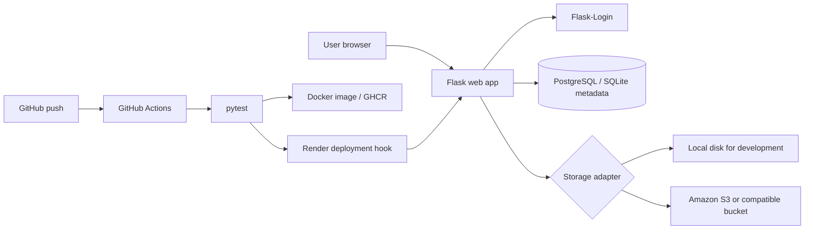

# CloudBox architecture

## Request flow

1. A user registers or signs in. The password is stored as a Werkzeug hash.
2. The upload endpoint validates the extension and creates a random storage key.
3. The file bytes go to local disk or S3 through the same `Storage` interface.
4. The database stores only metadata and the storage key, never the file itself.
5. Download and delete queries always include the current user ID, so users can only access their own records.
6. A push to `main` runs tests, builds a Docker image, publishes it to GHCR, and optionally triggers Render.
